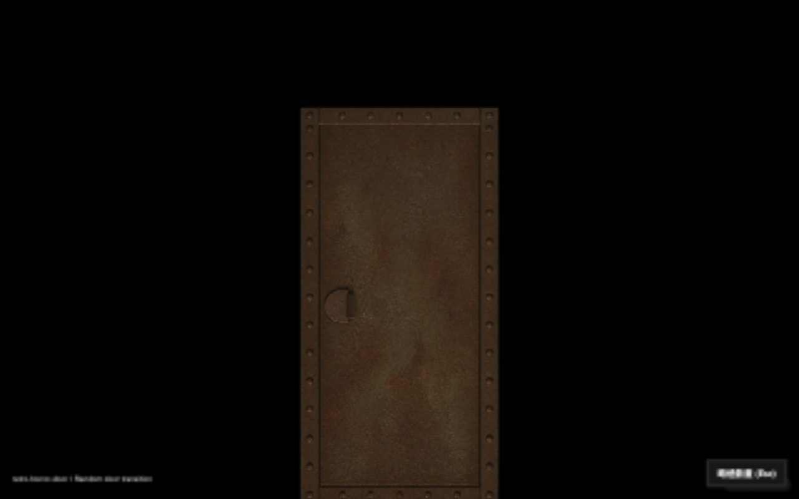

# Biohazard Abyss integration demo

Adds random retro-horror-door transitions to a local copy of the archived site.


The original Big5 bytes are preserved; each page receives one deferred UTF-8
script in its head (some archive pages have an unclosed analytics script in the footer).

Run from the repository root after `npm install`, with a local copy of the
archived website already available:

```sh
node examples/abyss/install.mjs \
  ~/Downloads/abyss.biohazard.2058info.com
python3 -m http.server 4181 --bind 127.0.0.1 \
  --directory ~/Downloads/abyss.biohazard.2058info.com
```

Open http://127.0.0.1:4181/biohazard1/index.html and select a section.
The library checkout must have its dependencies installed. The installer bundles
its library source plus Three.js and copies assets from its installed
retro-horror-door-assets package. No runtime CDN connection is required.
Re-run the installer after changing entry.js or the library; installation is idempotent.
A content hash in the script URL ensures updated bundles bypass old browser caches.
Playback waits for visual assets, and pagehide cancels pending transitions.
Serve over HTTP rather than opening file:// URLs.

Ordinary same-origin HTML links play a randomly selected published preset,
excluding the previous selection when sessionStorage is available. Original
_blank section links navigate in the current tab after playback. Modified clicks,
downloads, external links, same-page anchors and reduced-motion preferences keep
native behavior. Escape or the skip button navigates immediately. Mount failures,
WebGL context loss and a 20-second watchdog also continue navigation.

Source lives here; the downloaded site and generated bundle remain outside Git.
To remove the demo, remove the script tag marked data-abyss-door-demo from each
HTML head, then remove the site's door-demo directory.

Validation: `npm run test:example:abyss` covers link selection, random selection,
Big5 byte preservation and repeated installation. Manual browser checks cover
asset readiness, full animation completion/navigation, different subsequent
preset selection and Escape skipping.
